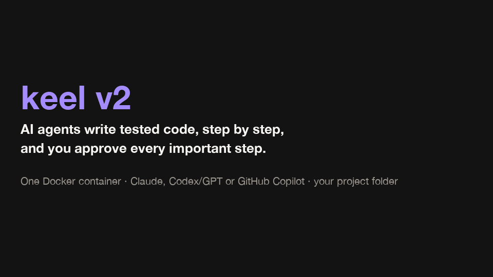

<p align="center">
  
</p>

<p align="center">
  <b>AI agents write <i>tested</i> code for your project. You approve the important steps.</b><br>
  Everything runs in one Docker container: a dashboard, a terminal app and an MCP server for your own AI tools.
</p>

<p align="center">
  <a href="https://github.com/MiladNalbandi/keel-v2/actions/workflows/ci.yml"></a>
  <a href="https://github.com/MiladNalbandi/keel-v2/releases/latest"></a>
  <a href="https://github.com/MiladNalbandi/keel-v2/pkgs/container/keel-v2"></a>
  <a href="LICENSE"></a>
</p>

<p align="center">
  <a href="https://github.com/MiladNalbandi/keel-v2/releases/download/v0.18.49/keel-v2-explainer.mp4">Video</a> ·
  <a href="#start">Install</a> ·
  <a href="docs/GUIDE.md">Guide</a> ·
  <a href="https://github.com/MiladNalbandi/keel-v2/wiki">Wiki</a> ·
  <a href="#plugins">Plugins</a> ·
  <a href="https://github.com/MiladNalbandi/keel-v2/releases">Releases</a>
</p>

<p align="center">
  <a href="https://github.com/MiladNalbandi/keel-v2/releases/download/v0.18.49/keel-v2-explainer.mp4"></a>
  <br><sub>The 4-minute tour (MP4): start, a flow, the Inbox, Code Review, KeelBot, plugins, the Supervisor, the terminal and the phone.</sub>
</p>

<p align="center">
  
  <br><sub><code>keel2</code>, keel's terminal app — recorded from a real run on keel's test model, not drawn.</sub>
</p>

<p align="center">
  
  <br><sub>The dashboard — recorded from a real keel v2 run (Claude Haiku on a small shop project), not drawn.</sub>
</p>

## Start

You need [Docker](https://docs.docker.com/get-started/get-docker/).

**1. Install keel** (once)

```bash
curl -fsSL https://raw.githubusercontent.com/MiladNalbandi/keel-v2/main/install.sh | bash
```

**2. Start it for your project** (a git folder). Your browser opens http://localhost:8080.

```bash
keel2 start ~/path/to/your/project
```

**3. Log in:** **Connections › Set up login**, then pick Claude, Codex, GitHub Copilot, Vertex AI or a local model
(Ollama, LM Studio, vLLM).

**4. Start work:** **Flow › Start a flow**. Write what you want. Approve when keel asks you (◆).

## How it works

```
 you: "show each player's rank"
         │
         ▼
  1. spec     an agent writes what to build              ◆ you approve
  2. test     an agent writes a test that fails
  3. code     an agent writes code until the test passes ◆ you approve
  4. review   agents check the whole change              ◆ you approve
         │
         ▼
 done: tested commits on a new branch. keel never pushes.
```

## What you see

| Page | What it shows |
|---|---|
| **Flow** | the running flow, step by step; several flows side by side (a tab each), each on its own branch; the history of every flow |
| **Inbox** | everything that waits for you |
| **Tasks** | your tasks or Jira tickets; **Start** runs a flow for one |
| **Code · Map · Graph** | the code with Source control (branches, commit, push, pull request), the database diagram, and what uses what |
| **Code › Review** | pull requests to review: threads, line comments, and keel's check of each comment ([below](#code-review)) |
| **KeelBot** (in Code, ⌘I) | ask about the code; which workflow fits a piece of work (and start it); ask about a running flow; write a workflow of your own; fix things while a flow waits at a gate, or try an idea on its own branch |
| **Workflows** | the workflows as blocks, in folders, with how often each ran |
| **Control › Plugins** | every plugin, on or off; **Database**, **Git**, **CI/CD** and **Code Review** also per project |
| **Quality** | how well each flow works with each model, run on small test projects; a drop shows in red |
| **Budget** | tokens and cost (a small bar shows it on top of every page) |
| **Help › Start here** | five set-up steps with what keel really sees (a project, a model, your AI tool over MCP, init, a first flow), and short guides with search; the first open shows a welcome with the tour |
| **Settings › Access** | where keel answers (this computer, Wi-Fi, Tailscale), your phones (pair one with a QR code, remove one: [below](#on-your-phone)), the AI tools that call keel over MCP, and updates |

## Plugins

keel is a small **core**. Everything else is a **plugin** that you turn on or off.

```
 keel core     flows, workflows, agents, gates, Inbox, budget, connections
   + Code      with Git, Code Review, Database and CI/CD inside
   + KeelBot   + Map   + Graph   + Wiki   + Tasks (with Jira)
   + Supervisor   + keel Product (beta)
```

**Control › Plugins** shows them. All plugins come with keel and are on. Turn one off, or add one from the
**Marketplace**, and keel restarts in about 30 seconds. `keel2 start --core` starts keel with no plugin inside.

## Code Review

<p align="center">
  
</p>

- **Review pull requests in keel:** the list (to review, assigned, mine), files, diff, checks, threads, multi-line comments and
  a pending review you send in one go (GitHub and GitLab).
- **✦ Is the reviewer right?** keel checks a comment against the code and answers point by point (they're right, you're
  right, partly, unclear) with a draft reply. One cheap call by default; the agent, model, effort and token cap are yours
  to set (Settings › Code Review threads). Nothing is posted for you.
- **✦ Address it** starts a small flow on the pull request's branch to make the change. keel never pushes.

## Supervisor

A plugin (off by default) that watches a project's flows like a careful colleague:

```
 flow waits at a gate ──► Supervisor reads the spec, the code, the rules and your earlier answers
                            ├─ sure     ──► answers it (or only suggests, in "shadow" mode)
                            └─ unsure, stuck or out of budget ──► calls you: an Inbox card with a short summary
```

It runs on a strong model, never raises a budget cap, and you can turn it on keel-wide, per project or per flow
(Control › Plugins, or `/supervisor` in `keel2`).

## Flows

| Flow | Use it to |
|---|---|
| **quick** | make a tiny change (one agent, the tests, one look) |
| **implement** | write the code, then its tests; done when they pass |
| **small** | build a small feature, test-first, without the long ship part |
| **feature** | build something new |
| **change** | make a small change |
| **fix** | fix a bug (first a test that shows it) |
| **diagnose** | find a bug you cannot repeat yet |
| **review** | review your branch (it changes nothing) |
| **lint** | fix formatting and lint problems |
| **cover** | add tests for the changed lines |
| **ship** | final checks and the pull request text |
| **hunt** | look for bugs |
| **init** | set up a project for keel |

## Commands

| Command | What it does |
|---|---|
| `keel2 start [folder]` | start keel |
| `keel2` | keel in your terminal: KeelBot, flows, gates, live agents and diagrams, with `/` commands, on a full screen that scrolls (also `keel2 tui`; `--inline` without the full screen) |
| `keel2 stop` | stop keel |
| `keel2 add <folder> [<folder> …]` | add more projects (each a git repo, or a folder of repos) |
| `keel2 folders` | which project folders keel has |
| `keel2 state [close]` | a state file keel v1 left in the project (it blocks commits): show it, or archive it |
| `keel2 status` | is keel running? |
| `keel2 update` | get the newest version |
| `keel2 doctor` | find problems and say how to fix them |
| `keel2 start --wifi` / `keel2 share tailscale` | use keel from your phone (pair it in Settings › Access) |
| `keel2 muxy hook` / `keel2 muxy workspace` | keel in [Muxy](https://github.com/muxy-app/muxy) (a macOS terminal): questions and flow results as Muxy notifications, a ready workspace ([more](docs/muxy.md)) |
| `keel2 help` | all commands |

**Something wrong?** Run `keel2 doctor`. It tells you what to do.

## On your phone

<p align="center">
  
</p>

The Android app ([android/](android/README.md)) answers keel's questions, follows flows, reviews pull request threads and
chats with KeelBot. Start keel with `keel2 start --wifi` (your Wi-Fi), or share it with `keel2 share tailscale` (https
on your tailnet) or `keel2 share tunnel` (a public https address). Then pair the app in **Settings › Access › Pair a
phone**: scan the QR code. It talks to keel directly; nothing goes through a server of ours.
[More](docs/GUIDE.md#use-keel-from-your-phone)

## In your JetBrains IDE

The keel plugin ([jetbrains/](jetbrains/README.md), IntelliJ IDEA, PyCharm, WebStorm and the other 2024.3+ IDEs)
brings keel into the editor: review threads on the pull request's diff with "Is the reviewer right?", the questions
your flows wait at (a balloon and "keel · N questions" in the status bar), Start a flow from a selection, and KeelBot
with its changed lines marked in the editor. Build it with `cd jetbrains && ./gradlew buildPlugin`, install the zip
(Settings › Plugins › ⚙ › Install Plugin from Disk), then connect in Settings › Tools › keel: keel2 on this computer,
or a pairing code like the phone.

## In VS Code

The keel extension ([vscode/](vscode/README.md), VS Code 1.90+) has the same features as the JetBrains plugin: your
flows with their live activity (the running agents, their edits, commands and tests), the questions they wait at (a
notification and "◆ keel: 1 question" in the status bar), review threads on the pull request's changed lines in the
normal editors, Start a flow, and KeelBot (Ctrl+Alt+K on a selection). Build it with
`cd vscode && npm ci && npm run package`, install it with `code --install-extension keel-vscode-0.1.0.vsix`, then run
**keel: Connect**: keel2 on this computer, an API key, or a pairing code like the phone. [More](docs/vscode.md)

## More

- [Guide](docs/GUIDE.md): run modes, Tasks and Jira, logins, where keel keeps its files (keel v1 layouts), Docker mode,
  MCP (read, write and admin levels), native mode without Docker (`keel2 start --native`), and how to build keel yourself
- [Plugins](docs/GUIDE.md#plugins-and-the-marketplace): keel core, turning plugins on and off, installing and
  publishing a plugin
- **Rules** (Build › Rules): see every rule your agents follow, install rule packs or write your own, and watch them in the Flow's "Rules now"
- [How the parts talk](docs/CONTRACT.md)

## License

MIT, see [LICENSE](LICENSE).
