# keel: the full feature proposal, with the system before and after

Research for [#254](https://github.com/MiladNalbandi/keel-v2/issues/254), 2026-11-26, for keel 0.41.1. Nothing here
is built. This is a proposal to decide on.

**The question.** What should keel become in the next month, so that an agent with keel is smarter and cheaper
than one without, and three agents on one keel finish sooner and with fewer tokens than three agents without it?

**keel's goal, used to judge everything here.** keel is a tool an agent connects to. It makes the agent smarter and
more efficient. It does not control or manage agents. Several agents on one keel must be more efficient together.
By default keel writes no file into the user's project. Inside `.git` it adds only what git itself needs for the
work: branches, commits and worktree records (decision 2 below).

**The answer in one sentence:** fix two bugs, make keel cost almost nothing to connect to, let an agent use keel
without starting a flow, share what is expensive to find twice, and run the same test every week to see if it
worked.

**Words used in this report**

| Word | Meaning |
|---|---|
| agent, connected agent | A coding program driven by an AI model (Claude Code, Codex, Cursor). It is "connected" when it talks to keel. |
| MCP, tool | MCP is the standard way an agent talks to a helper program such as keel. A tool is one thing the agent can ask keel to do. |
| tool definition | The text that tells the agent what a tool does. The agent has to read it, so it costs tokens. |
| token | The unit in which a model's reading and writing is counted and paid. About four characters. |
| fixed cost | Tokens an agent pays only for being connected to keel, before it does any work. |
| session | One agent's connection to keel. |
| flow, gate | A flow is keel's fixed order of steps for one piece of work. A gate is a step where keel stops and waits for the person's OK. |
| `harness` flow | The one flow a connected agent can run today: plan, build, keel runs the tests, the person looks, keel commits. |
| work order | The text keel gives a connected agent for the next step of a flow. |
| Inbox | The page in keel where the person answers gates and other questions. |
| worktree | A second working folder of the same git repository, on its own branch. Git's own feature. |
| light path | New in this proposal: using keel's help with no flow and no gate, in a worktree keel gives the agent. |
| brief | Five lines keel gives an agent at the start: the stack, the rule files, the test command, who else is working. |
| hook | A small setting in the agent's own program that runs something at a fixed moment, for example at session start. |
| claim | A note "I am working on these files" with a time limit. It warns others. It blocks nobody. |
| the race | The test of [K1]: three small tasks, done by plain agents and by agents through keel, timed and counted. |
| arm | One way of running the race, for example "three plain agents" or "three agents on keel's light path". |
| baseline | The first measurement, which later ones are compared with. |
| person bot | A script that clicks OK at the gates within about 2 seconds, so the race does not wait for a human. |
| hidden checks | Four checks of the result that the agents cannot see. They show if the work is really right. |
| meter | New in this proposal: keel counts its own tool calls, answer sizes and waiting times. |
| prompt cache | The model provider keeps the unchanged start of a conversation, so it is cheap to send again. It is lost when the tool list changes. |
| goldfish, elephant | Two kinds of reviewer. A goldfish reads the work with no memory of earlier rounds. An elephant knows them. |

## Answer in short

1. **keel loses the race today to bugs and to fixed cost more than to missing features.**
   - Time: two bugs are the largest known part of the 7.6 minutes
     ([#217](https://github.com/MiladNalbandi/keel-v2/issues/217),
     [#218](https://github.com/MiladNalbandi/keel-v2/issues/218)). Part of the time is not explained yet.
   - Tokens: the fixed text of the work orders is the extra tokens that were measured.
   - Design: to work through keel, a connected agent must start a flow with gates.
   - Missing: nothing is shared between agents, so three branches met in a conflict.
   - Not in the race at all: keel's 131 tool definitions. An agent program that loads every definition pays them
     on top. Section 1.
2. **Add a light path.** Today an agent can read from keel without a flow (search, knowledge pages, the commit
   style). But to get its own worktree and branch from keel, or keel's test run for its own change, it must start
   a flow, and that is always the `harness` flow. With the light path an agent uses keel's knowledge, test runs and
   "who works on what" with no flow and no gate, in a worktree outside the project. Flows with gates stay, for work
   the person wants to look at. This is the change that can flip the race. Section 3, feature 7.
3. **Make keel's fixed cost close to zero.** The brief arrives at session start through a hook, with no tool call.
   The agent tool set is small (12 tools at first). Every answer has a size limit. The same answers also work from
   the shell (`keel2 howto commit`), with no tool definitions at all. One public test shows how large the effect
   can be: the same GitHub task cost 1,421 input tokens from the shell, 23,228 with a 2-tool MCP server, 5,357
   when that server's answers were cut short, and 59,417 with 46 tools [R45]. A second test also found a large gap
   [R46]. A third found none [R47]. So the shell path is a guess until keel's own race. Section 3, features 2 to 6.
4. **Share what is expensive to find twice.** Test results (same code, same result, no second run), facts with a
   citation, who touches which files (read from git, not from what agents say), and a warning before two branches
   collide. Section 3, features 11 to 16.
5. **Measure first, and every week.** A race harness and a meter come in week 1, before any feature. One public
   study found an MCP code tool that saved 14% of the tokens and lost 7 points of solved tasks [R48]. keel must
   not ship a tool like that without knowing. Sections 5 and 6.
6. **27 features are ranked** in section 3: 10 from the plans that exist and 17 new ones. Each has its goal, effort
   and a way to measure it. The month covers 17 of them. The other 10 wait for the race result.

How sure:

- **high** that the fixed text costs tokens: keel measured 26k to 32k tokens per keel agent against about 20k [K1];
- **medium** that the two bugs are most of the lost time. The "4 to 5 minutes" for #217 is the test report's own
  estimate. The one-agent keel run took 4.6 minutes, and only 90 s of that is explained by #218 [K1]. So about
  3 minutes have no known cause yet;
- **medium to high** on the fixed-cost rules of point 3: several sources agree and two measured it, but never on
  keel's own tools;
- **medium** on points 2 and 4: the patterns are well documented, but no public study measures them for a tool like
  keel, and the one paper that reports a large gain is by the tool's own author [R7];
- **low** on the size of the gain. The targets in section 6 are our estimates. On three tiny tasks the margin
  against plain agents is thin, and one plain agent doing all three tasks (17 s, 20k tokens) will stay the cheapest.

**Decisions this proposal asks from the maintainer.** They are choices, not facts, so they are listed here:

1. **The light path has no gates and no rule guard.** The agent runs in its own program, as it does without keel.
   Is the light path on by default, with a switch per project to turn it off? We suggest yes.
2. **What keel may add inside `.git` by default.** For each light-path task: one branch and one worktree record.
   For each landing: one `keel/land-…` branch. No file in the working folder, no line in `.git/info/exclude`,
   nothing pushed. The no-`.keel`-folder plan allows branches and worktree records. This proposal uses that on a
   new path. Agreed?
3. **Hooks** are the person's own settings of the agent program. keel prints them. It installs them only when
   asked, and only into the person's own settings, never into the project. Agreed?
4. **The final race moves to the first week of January**, because 25 December is a holiday. And each week's build
   needs an OK, because the stop on new features of 2026-11-18 still stands.
5. **The race needs a test machine where the agent program can sign in**, so keel can be connected the real way.
   The first race could not do that [K1].

**What this report builds on.** It does not repeat these:

- [K1] the MCP test report, `docs/test-report-mcp-0.40.0.md` (the three-agent race);
- [K2] the agent toolkit plan, `docs/research/agent-toolkit-plan.md` (`keel_howto`, `keel_brief`, the small tool set);
- the two plans in review: fewer Inbox OKs ([#250](https://github.com/MiladNalbandi/keel-v2/issues/250)) and no
  `.keel` folder ([#246](https://github.com/MiladNalbandi/keel-v2/issues/246)).

**About the diagrams.** Each diagram is shown as a picture, with its Mermaid source folded under it and SVG and PNG
files in `docs/research/img/keel-proposal/`. The pictures were made from that source with Mermaid's own tool.
Whether GitHub's own Mermaid viewer draws all seven is not confirmed (section 8).

## 1. keel today

### 1.1 The system before

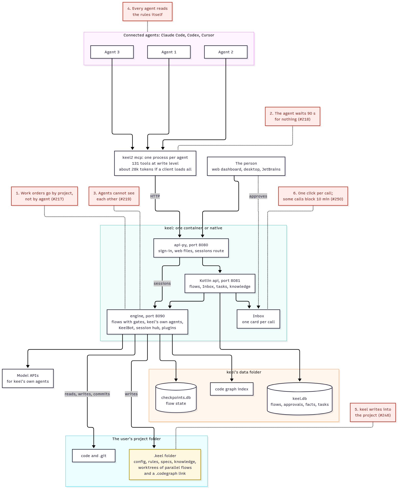

Larger: [SVG](img/keel-proposal/system-before.svg) · [PNG](img/keel-proposal/system-before.png)

<details>
<summary>Mermaid source of this diagram</summary>

<!-- diagram: system-before -->
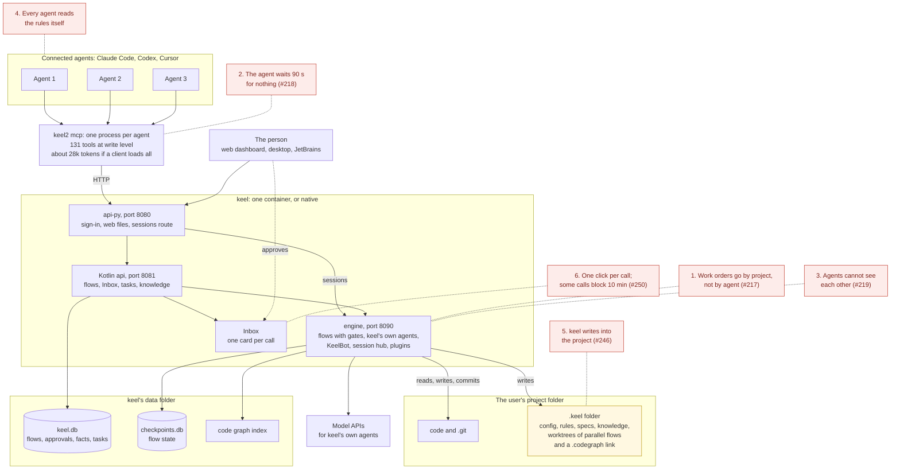

</details>

How to read it (checked in the code of 0.41.1):

- **Three servers.** `api-py` is in front on port 8080. It passes most routes to the Kotlin api (8081) and the
  session routes straight to the engine (8090). The engine runs the flows, keel's own agents and the plugins.
- **One MCP process per agent.** `keel2 mcp` is a small program each client starts. It calls the api over HTTP. It
  has three levels: 69 tools at read, 131 at write, 141 at admin in 0.40.0 [K1]. 0.41.0 added one at the read
  level (`keel_commit_style`), so today it is 70, 132 and 142. This report keeps 131, the number that was measured.
  There is no small set for agents yet.
- **To work through keel, a connected agent must run the `harness` flow.** `keel_start_flow` with `engine=session`
  turns quick, small, implement, feature, change and fix into `harness`: plan, a plan gate (when plan mode is on),
  build, keel's tests, a done gate, commit, a PR gate. Without a flow an agent can read from keel
  (`keel_search`, `keel_knowledge`, `keel_commit_style`, `keel_citations_check`) and can call `keel_ci_run` and
  `keel_branch_sync`. What it cannot get without a flow is its own worktree and branch from keel, or keel's test
  run for its own change.
- **Two SQLite files and the project folder.** Flows, Inbox cards, facts and tasks are in `keel.db`. Flow state is
  in `checkpoints.db`. Config, rules, specs, knowledge pages and the worktrees of parallel flows are in `.keel/`
  inside the project. The code graph's index is in keel's data folder, with a `.codegraph` link to it in the
  project. Sessions and waiting questions are held in the engine's memory.
- **The six red boxes** are the problems this proposal removes. Each has an open issue or a plan.

### 1.2 One job with three agents, before

The job from the test report [K1]: three small tasks in a `shop` project (`discount()`, `Cart.remove()`,
`Inventory.restock()`), each with a test and a CHANGELOG line, and a rules file `docs/CONVENTIONS.md`.

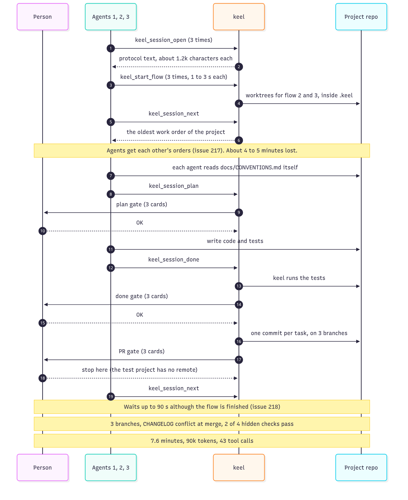

Larger: [SVG](img/keel-proposal/job-before.svg) · [PNG](img/keel-proposal/job-before.png)

<details>
<summary>Mermaid source of this diagram</summary>

<!-- diagram: job-before -->
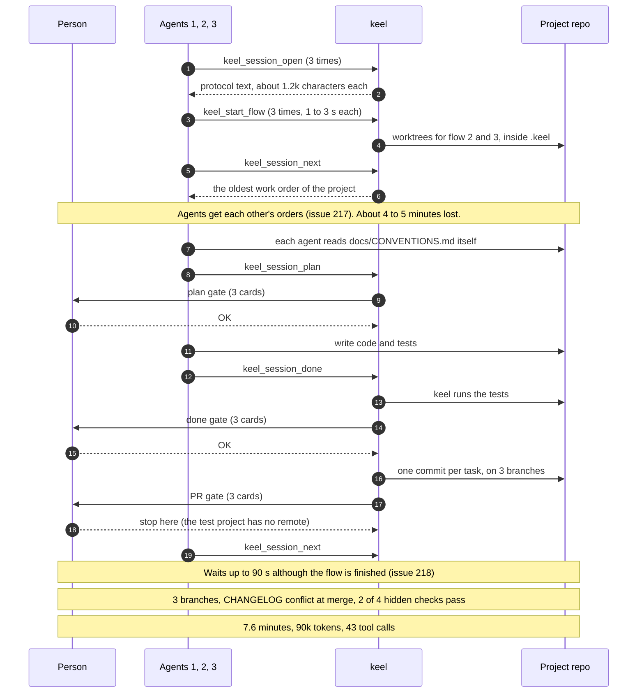

</details>

The steps and numbers are from [K1]. The size of the protocol text is from the code
(`engine/keel_engine/mcp_session.py`). The plan gate is there because the test ran with plan mode on.

### 1.3 Where the time and the tokens went

| Run [K1] | Wall time | Tokens | Tool calls | Hidden checks |
|---|---|---|---|---|
| plain, 1 agent, 3 tasks | 17 s | 20k | 4 | 4/4 |
| plain, 3 agents, one folder | about 25 s | 60k | 17 | 4/4 |
| keel, 1 agent, 3 flows | 4.6 min | 31k | 14 | 4/4 |
| keel, 3 agents, 3 flows | 7.6 min | 90k | 43 | 2/4 after merging |

| Cost | Size | Cause | Kind |
|---|---|---|---|
| Wrong work orders | 4 to 5 of the 7.6 minutes (the test report's estimate) | `keel_session_next` hands out the oldest order of the project (#217) | bug |
| Waiting for nothing | 90 s per wait | `keel_session_next` waits its full time when the flow is done or waits for the person (#218) | bug |
| Gates | seconds with the test's "person bot", minutes with a real person | to work through keel, a connected agent must run the `harness` flow, which has up to three gates | design |
| Fixed text | 26k to 32k tokens per keel agent against about 20k plain | the work order's standing text and the session protocol | design |
| Tool list | up to about 28k tokens per agent, **not counted in the race** | the test agents used a bridge and never loaded keel's 131 tool definitions [K1] | design |
| Repeated reading | 7 of 8 agents read the conventions file themselves | no shared knowledge an agent can ask or add to | missing |
| Merge | 2 of 4 hidden checks after merging | three branches all added a CHANGELOG line; nothing warned or helped | missing |
| Presence | n/a | `keel_live` says "no agent is running" while three work (#219) | bug |

Three things follow.

- **The race is lost to bugs and fixed cost more than to missing features.** Fixing #217 and #218 should remove a
  large part of the time. How large is the first thing the week 1 baseline has to show, because about 3 minutes of
  the one-agent keel run have no known cause yet.
- **In some clients the token gap is larger than measured.** A client that loads every tool definition pays about
  28k tokens per agent before any work. Claude Code, the client of the race, does not: it loads tool names and the
  server's instructions first and the rest on demand, so there the gain of a small set is "a shorter list and
  fewer wrong picks" [K2]. The small tool set matters most for clients that load everything.
- **The plain three-agent run was not clean either.** One agent's CHANGELOG line went into another's commit, and one
  could not stage its line because HEAD kept moving. Three agents needed 17 tool calls; one agent alone needed 4
  for all three tasks [K1]. This waste is what keel can remove, and it is where a win on time and tokens can come
  from.

Two more internal results, both from 2026-11-26 and neither in this repository yet:

- **keel's own machinery is fast.** In the end-to-end test of 0.41.1, keel's `feature` flow with a stub model ran in
  a median of 27 s for 8 gates, and a gate answer took about 0.24 s (five runs, on a machine other jobs shared;
  the same test gave 13.6 s on 0.40.1, so 27 s is not a proven slowdown and not a best case either). The minutes
  in the race come from the connected-session path, not from flows as such.
- **Building through the `harness` flow with a connected session works, with friction.** In the squad's experiment
  (three build runs and a few review rounds) it worked end to end at zero keel tokens, but needed about three workarounds per run and was slower
  than the plain loop on a similar fix round. The log's own words: this "does show B adds no quality by itself (keel
  only ran the same tests the agent ran)".

## 2. What others do

The toolkit plan [K2] already covers how agents read rule files (`AGENTS.md`, `CLAUDE.md`, Cursor rules), the basic
MCP tool rules, and worktrees, lock files and Copilot Memory. This section adds what that plan lists as "not opened"
and what is new since. Sources are at the end; "✔✔" there means two readers checked the page.

### 2.1 Shared memory

| Tool | How a memory is made | Shared with | Stale or wrong memories | Source |
|---|---|---|---|---|
| GitHub Copilot Memory | the agent stores a fact with citations to code | every Copilot surface on the same repository (cloud agent, code review, CLI, VS Code) | citations are checked against the current branch before use; repository facts expire after 90 days by default (7 to 180, set by the owner) | [R18] [R19] |
| Claude Code auto memory | Claude writes one file per memory plus an index | one machine, one repository; not other machines, not the cloud | only the first 200 lines or 25KB of the index load; Claude is told to merge or drop old entries | [R20] |
| Codex memories | made in the background from past chats; off by default | one machine | "a helpful recall layer, not ... the only source for rules that must always apply" | [R21] |
| Devin Knowledge | a person accepts what Devin suggests; each item has a trigger | organisation | retrieved "when relevant, not all at once"; now being moved to Skills | [R22] |
| Beads | `bd remember` stores a fact, `bd prime` injects the facts later | everyone with the project's database | old closed tasks are summarised ("memory decay"); ids are hashes so parallel branches do not collide | [R11] |
| mem0 | a model extracts facts from the conversation | by user, agent or run id | the automatic path only adds: a changed fact is stored next to the old one | [R23] |
| Letta | "memory blocks" in the prompt; one block can be attached to several agents | the agents that share the block | "last write wins": two writers overwrite each other | [R24] |
| Zep / Graphiti | facts as edges in a graph, each with a time window | by graph | "old facts are invalidated - not deleted" | [R25] |
| MCP reference memory server | entities with short observations, in one file | whoever shares the file | the whole file is rewritten on every write; "By default nothing caps the graph." | [R28] |

What is measured:

- **Citations work.** Copilot's coding agent merged 90% of its pull requests with memory against 83% without. In a
  test with false memories planted on purpose, agents "consistently verified citations, discovered contradictions,
  and updated incorrect memories" [R19]. Cross-agent sharing is shown there as an example, not measured on its own.
- **Memory can hurt.** MemDev-Bench (October 2026): "Memory also causes failures on otherwise solvable tasks even
  with related history" [R29]. REM (October 2026) did better with less: a short summary at the start and more only
  when the agent struggles gave 27.6% against 24.9% solved at 17% lower cost, and "the bottleneck in experience
  reuse is not retrieval fidelity but how experience is stored and governed" [R30].
- **Memory can be attacked.** One paper shows that a single bad write keeps working for a long time and that
  prompt-injection defences do not cover it [R31]. Cisco described an attack on Claude Code that rewrote each
  project's `MEMORY.md` and the user's hook settings and, in the authors' words, "persists across all projects,
  sessions, and reboots" [R32]. Hook settings are also where keel's hook install would write (feature 5).
- **Vendor benchmarks disagree.** mem0 and Zep each publish numbers on the LoCoMo test in which the other loses.
  Letta reports that a plain agent with a file system beat mem0's published score (74.0% against 68.5%) [R26] [R27].
  These sources are older than a year, but the point stands: do not copy a number, measure.

### 2.2 Several agents on one repository

| Who | What they tried | What happened | Source |
|---|---|---|---|
| Cursor (hundreds of agents) | locks on shared state | "20 agents would slow to the throughput of 1-3 with most time spent waiting on locks" | [R3] |
| Cursor | an integrator that merges everything | "It quickly became an obvious bottleneck", removed | [R3] |
| Cursor, final design | workers "don't communicate with any other planners or workers"; overlaps are accepted | "we accept some moments of turbulence and let the system naturally converge …" | [R3] |
| Cognition (Devin), April 2026 | one writer, other agents only add thinking | works: "multiple agents contribute intelligence to a task while writes stay single-threaded"; of parallel-writer ideas, "most ... still don't see meaningful adoption" | [R4] |
| Claude Code agent teams | shared task list, claims, messages between teammates | "Task status can lag"; about 7x the tokens of one session when teammates plan; a message from another session costs a full turn with the whole context | [R1] [R2] |
| Beads | a "ready" list and an atomic claim (`bd update <id> --claim`) | agents pick only tasks with no open blocker | [R11] |
| mcp_agent_mail | file claims ("leases") with a time limit, which only warn | "reservations are still granted; conflicts are returned alongside grants"; the README asks for specific path patterns and says "Reservations expire but aren't cleaned up" | [R12] |
| Gas Town | a "Mayor" agent that hands out work, a merge queue, watchdogs for stuck agents | a full manager design: the opposite of keel's goal, but its merge queue and "stuck" view are useful ideas | [R13] |
| GitHub mission control | one page for all agent sessions | advice only: "Agents working in parallel can create merge conflicts if they touch the same files" | [R14] |

What is measured:

- **Two agents working together did worse than each alone.** CooperBench (January 2026, over 600 tasks): "agents
  achieve on average 30% lower success rates when working together" than when each works alone [R6]. In that test
  the agents coordinate by sending each other messages. It does not compare messages with a shared board, so it is
  a warning about agent-to-agent chat, not proof for a board.
- **Different agents collide twice as often.** In 33,596 agent pull requests, pairs from different agents had a
  41.7% merge-conflict rate against 19.8% for pairs from the same agent, and nearly 42% of the conflicts were
  structural, not just two edits in one line [R8]. A second study of 142K agent pull requests found 27.67% in
  conflict with the base branch [R9].
- **Shared state before the pull request helps, says the tool's own author.** The paper on `grite` (June 2026)
  reports that work re-doing a teammate's task fell from 78% to 0% with a signed, append-only event log kept in
  git [R7]. It is one author's own tool and benchmark; we read the abstract only.
- **Awareness helps the person too.** With a dashboard of parallel agent work, 16 people finished about 63% more
  tickets on short tasks, although they did not feel more in control [R10].
- **Nobody has measured the speed-up of parallel coding agents independently.** We found vendor statements only.
  Anthropic: multi-agent systems use "about 15x more tokens than chats", and "most coding tasks involve fewer truly
  parallelizable tasks than research" [R5] (older than a year).

Bringing branches together: GitHub's merge queue tests each pull request on top of the ones before it and removes
the one that fails [R15]. Git's `merge=union` keeps the lines of both sides for append-only files, but "tends to
leave the added lines in the resulting file in random order" [R16]. towncrier avoids the problem with one small file
per change [R17].

### 2.3 MCP design and token cost

| Finding | Number | Source |
|---|---|---|
| The same task ("latest release and three bug issues" on GitHub), Claude Sonnet 5.5 | CLI 1,421 input tokens · skill 3,315 · MCP with 2 tools 23,228 · the same with results cut at 4,000 characters 5,357 · MCP with 46 tools 59,417 · with 91 tools 101,351. So the size of the results costs as much as the number of tools. One task, one server; loading tools on demand helped one model and cost more on a smaller one | [R45] |
| Claude Code's own advice | "Prefer CLI tools when available ... they don't add any per-tool listing" | [R2] |
| Claude Code loads MCP tools on demand | "Only tool names and server instructions load at session start"; instructions and upfront descriptions are cut at 4,096 characters | [R36] |
| Too many tools hurt the choice | "Claude's ability to pick the right tool degrades once you exceed 30–50 available tools" | [R43] |
| A changed tool list is expensive | changing tool definitions invalidates the whole prompt cache; the spec now says servers "SHOULD return tools from `tools/list` in a deterministic order" | [R44] [R33] |
| Tool results are capped by the client | Claude Code: 25,000 tokens by default, a warning at 10,000 | [R36] |
| Slow calls | Claude Code moves a call to the background after two minutes; Codex's default tool timeout is 60 s | [R36] [R39] |
| A brief with no tool call | Claude Code's `SessionStart` hook adds context "at the start of the conversation, before the first prompt", up to 10,000 characters, and a hook can be of type `mcp_tool`. Codex, Copilot CLI and Cursor have a session-start hook too | [R37] [R40] [R41] [R42] |
| Waiting for a person | the MCP Tasks extension names "human approvals": the server returns a handle "instead of blocking", the client polls; both sides must opt in | [R34] |
| Server push to the model | found in one client only: Claude Code "channels", a research preview behind a flag | [R38] |
| Skills over MCP | an official extension; Claude Code loads skills from servers in public beta | [R35] [R36] |

The newest MCP specification is 2026-07-28. It removes sessions and the `initialize` handshake ("Servers that need
cross-call state use explicit, server-minted handles passed as ordinary tool arguments"), adds a required
`server/discover` call, moves tasks into an extension, and deprecates sampling, roots and logging [R33]. For keel:
an agent's identity must be a handle keel gives out, not the connection.

What support each client has differs a lot (resources, prompts, hooks, timeouts). The safe design is the lowest
common one: few tools, fast answers, short results, no reliance on push.

### 2.4 Project knowledge and code tools

- **An MCP code tool can cost solved tasks.** `mcpbr` (February 2026, one independent author) ran a code-graph MCP
  server on all 500 SWE-bench Verified tasks: 42.3% fewer tool calls, 14.0% fewer tokens, 15.2% lower cost, and
  the solved rate fell from 49.8% to 42.4%. It helped on 1 of 12 repositories and hurt on 10 [R48]. keel's own
  test of 2026-10-06 agrees in kind: pre-fetched "where to look" hints saved no tokens [K2].
- **Overviews do not help; unusual rules do.** The ETH Zurich study found that repository overviews did not help,
  that context files raise cost by over 20%, and that they are "useful for specifying non-standard coding
  practices" [R50].
  Of 98 public agent skills, 92 had no significant effect; the average pass rate moved from 76.6% to 76.9% [R51].
- **Semantic search adds a little to grep.** Cursor's own A/B test: +0.3% code retention overall, +2.6% on
  repositories with 1,000 files or more (vendor number, three weeks older than a year) [R49].
- **Rules learned from review need a life cycle.** Cursor Bugbot turns review feedback into candidate rules,
  promotes them, can disable them on bad signal, and lets a person edit or delete them [R53]. CodeRabbit learns
  from chat replies; an admin can approve a learning and a person can edit or delete it [R54].
- **Session history is kept next to git by some tools.** Entire saves a checkpoint (transcript, files, tokens) per
  commit in its own git ref [R55]. We found no product that tells an agent "another agent already tried this and
  it failed".

### 2.5 How to measure

- GitHub's Copilot team: "token count of individual interactions alone isn't a meaningful measure of efficiency".
  A tool that shortened output made agents re-run commands: "We saved tokens locally and spent more globally."
  They compress install, build and test output "only when the savings are substantial", keep the original, and
  watch for agents re-running commands or opening the original [R52].
- One run means little: on SWE-bench Verified "single-run pass@1 estimates vary by 2.2 to 6.0 percentage points
  depending on which run is selected", so "reported improvements of 2--3 percentage points may reflect evaluation
  noise" [R56]. Anthropic found the machine's resource limits alone moved a benchmark by 6 points [R57].
- `mcpbr` is the only method we found for "the same agent with and without this MCP server": same tasks, same
  model, paired runs [R48]. No public benchmark tests several agents sharing one tool.

### 2.6 What nobody does yet

We did not find any tool that does these. They are where keel can be first, and also where there is no proof yet.

1. Answers "how do we do X in this repository" from the repository's own configs and history, with a source and a
   confidence [K2].
2. Shares **test results** between agents on the same code.
3. Tells an agent before it starts: "these two live branches will conflict in this file."
4. Tells an agent "this was tried and failed, here is why."
5. Gives several different agents (Claude Code, Codex, Cursor) one memory with checked citations. Copilot does it
   for its own surfaces only.

## 3. The proposal

### 3.1 Nine rules, each from evidence

| # | Rule | Why |
|---|---|---|
| 1 | Answer when the agent asks; push almost nothing | Overviews did not help and context files cost over 20% more [R50]; keel's own pushed hints saved nothing [K2]; a short start plus more on demand won in REM [R30] |
| 2 | Add to grep and read, never replace them | A code tool saved tokens and lost solved tasks [R48] |
| 3 | Every answer has a source, or says "not found" | Checked citations are what made Copilot's memory work [R19] |
| 4 | Show, do not block | Locks cut 20 agents to the speed of 1 to 3 [R3]; advisory leases return the conflict with the grant [R12] |
| 5 | Read the state from git, not from what agents report | "Task status can lag" [R1] |
| 6 | No chat between agents; one board they read | Two agents coordinating by messages solved 30% less than each alone [R6]; a pushed message costs a full turn [R2]. That a board does better is our inference |
| 7 | Fixed cost near zero: few tools, short answers, a size cap | One task: 1,421 tokens by CLI, 23,228 with a 2-tool MCP server, 5,357 with its results cut short, 59,417 with 46 tools [R45]. keel's own tools are not measured yet |
| 8 | No keel file in the project; keel's own store | keel's rule, [#246](https://github.com/MiladNalbandi/keel-v2/issues/246) |
| 9 | Judge by the finished job, over several runs | "We saved tokens locally and spent more globally" [R52]; one run varies by 2 to 6 points [R56] |

### 3.2 The base (not features)

These must be done first. Nothing below pays off while they are open.

| Work | Issue or plan | Gain |
|---|---|---|
| Work orders go to the agent that started the flow; `keel_session_next(flow=…)` | [#217](https://github.com/MiladNalbandi/keel-v2/issues/217) | about 4 to 5 minutes in the race |
| `keel_session_next` answers at once when the flow is done or waits for the person | [#218](https://github.com/MiladNalbandi/keel-v2/issues/218) | 90 s per wait |
| Connected sessions are visible | [#219](https://github.com/MiladNalbandi/keel-v2/issues/219) | needed by features 12 and 13 |
| No wasted Inbox cards; no call blocks for 10 minutes | [#250](https://github.com/MiladNalbandi/keel-v2/issues/250) part A (#221, #222, #226, #227) | Codex gives a tool call 60 s by default [R39], so a 10-minute block fails there |
| keel's files out of the project | [#246](https://github.com/MiladNalbandi/keel-v2/issues/246), plan `docs/plans/no-keel-folder.md` (in review on its branch). The plan has four phases and changes the default only in the last. The month needs phase 1 and, pulled forward from phase 3, keel's own worktrees folder | keel's rule; feature 7 must not be built on today's worktree code, which writes into `.keel/worktrees` |

### 3.3 All features, ranked

Goal: **smarter** (the agent knows the project), **cheaper** (fewer tokens for one agent), **together** (several
agents finish sooner). Effort: S = days, M = about a week, L = more. "From": K2 = the toolkit plan, #250 = the
fewer-OKs plan, **new** = proposed here. ★ = needed for the race to flip. The rows are in rank order. The build
order is the week table in section 5. It differs from the rank where one thing waits for another: feature 7 waits
for keel's own worktrees folder, and 17 is early because its plan exists. The rank is our judgement of gain against
effort, with the evidence named; the numbers are not measured yet.

| # | Feature | Goal | Effort | From | Evidence | How to measure |
|---|---|---|---|---|---|---|
| 1 ★ | **Meter and race harness**: keel counts every tool call (bytes out, repeats, seconds waiting for the person); `keel2 bench race` runs the three-task job with and without keel | all three | M | new | [R48] [R52] [R56] | it exists when the baseline of section 6 is recorded with 5 runs per arm |
| 2 ★ | **Agent tool set** `keel2 mcp --agent`: 12 tools in week 2, about 17 by week 4 | cheaper | S | K2 | [R43] [R45] | bytes of tool definitions: about 114 KB today, under 12 KB for the 12, under 16 KB for the 17 |
| 3 ★ | **Tool hygiene**: every answer capped at 4,000 characters with a `detail` switch, a fixed tool order, descriptions under 600 characters, the first 512 characters of `instructions` stand alone | cheaper | S | new | [R33] [R36] [R39] [R45] | median and largest answer size per tool in the meter; prompt-cache misses in the client |
| 4 ★ | **Slim work orders**: the fixed text of a work order under 1,500 characters; the protocol once per session | cheaper | S | new | [K1] | tokens per keel agent in the flow path: 26k to 32k today, within 2k of plain |
| 5 ★ | **`keel_brief`, delivered by the client's hook**: five lines at session start, no tool call | smarter, cheaper | S | K2 + new | [R37] [R40] [R50] | tool calls before the first edit; agents that open the rules file themselves |
| 6 | **Shell path**: `keel2 brief`, `keel2 howto`, `keel2 who`, `keel2 test` print the same answers; one skill teaches them | cheaper | S | new | [R2] [R45] | tokens per agent, shell arm against MCP arm, in the race |
| 7 ★ | **Light path**: `keel_workspace(task)` gives a worktree outside the project and a branch; keel's help works with no flow and no gate | together, cheaper | M, after keel's own worktrees folder exists (#246) | new | [K1] [R3] [R4] | wall time and tokens of the three-agent race; commits that hold another agent's lines (target 0) |
| 8 | **`keel_howto(topic="commit")`**, which replaces `keel_commit_style` | smarter | S | K2 | [K2] | commits in the project's style on the first try (hidden check) |
| 9 | **`keel_howto`** topics `branch`, `test`, `style`, `pr` (the topic `where` stays out until a test shows it saves reads, as [K2] says) | smarter | M | K2 | [K2] [R50] | calls per session; reads of `CONTRIBUTING` and CI files by agents |
| 10 ★ | **`keel_test(scope)`**: keel's own test command; one line when green, the failing assertions and a path to the full log when red. It grows out of `keel_ci_run`, which exists | cheaper, smarter | M | K2 + new rule | [K1] [R52] | tokens of test output per job; how often the agent opens the full log |
| 11 | **Shared test results**: the same code and command are not run twice; keel's own check reuses the agent's run | cheaper, together | M | new | none found (section 2.6) | test runs per job; seconds of test time saved |
| 12 ★ | **`keel_who`**: who is connected, on which branch, changing which files, read from sessions and git | together | M | K2 | [R1] [R7] [R10] | jobs where two agents did the same task (target 0) |
| 13 | **`keel_claim(paths, minutes, why)`**: a note that expires; activity in the worktree renews it; overlap is told, never refused | together | S | K2 + new | [R3] [R12] | claims that expired unused; overlaps told before the edit against found at merge |
| 14 | **`keel_remember(fact, cite)`** and recall, with the safety rules of section 3.5 | smarter, together | L in full; the month ships a first slice (M) | K2 + new | [R18] [R19] [R29] [R31] | hidden-check pass rate with and without; wrong facts found on the Knowledge page |
| 15 | **Merge radar**: keel test-merges the live branches in the background and says which will conflict, in which file | together | M | new | [R8] [R9] | conflicts predicted against conflicts met at merge |
| 16 ★ | **Land in order**: `keel_land(branches)` merges finished branches one after another into a new branch in keel's worktree, runs the tests on the result, names the branch that breaks | together | M | new | [R15] [R16] [K1] | hidden checks after merging: 2 of 4 today, 4 of 4 |
| 17 | **One OK for many calls** | together | M | #250 | #250 | clicks per job; seconds agents wait for the person |
| 18 | **Handoff notes**: `keel_note(done, next, open)`; the next agent on the branch gets the last one in its brief | smarter, together | S | new | [R55]; the squad's own habit | tool calls before the first edit when a second agent takes over a branch |
| 19 | **Traps**: "tried and failed" facts, offered by keel when the same test failed twice and then passed | smarter, together | M | new | none found (section 2.6); [R29] warns | repeated identical failures across agents |
| 20 | **Ready list**: `keel_tasks(ready=true)` from the Tasks plugin; taking a task says who has it | together | M | new | [R7] [R11] | two agents on one ticket (target 0) |
| 21 | **Review record**: `keel_review_history` gives any reviewer the earlier rounds and what was fixed | smarter, together | S–M | new | [R4]; a small internal sample | real findings per review round; findings repeated from an earlier round |
| 22 | **Waiting without blocking**: MCP Tasks where the client supports it; a push in Claude Code when a gate is answered | together | M–L | new | [R34] [R38] | seconds between the person's OK and the agent's next call |
| 23 | **Agents panel** for the person: sessions, branches, files, predicted conflicts, what waits for you. Read-only | together | M | new | [R10] | the person's time per job (to be asked, not measured) |
| 24 | **`keel_about(paths)`**: the facts, people and last changes for the files the agent is about to touch | smarter | M | new | [R48] warns | only shipped if the race shows no loss in hidden checks |
| 25 | **Learned rules** from gate notes and repeated review findings: candidate, approved by the person, switched off on bad signal | smarter | L | new | [R53] [R54] | findings of the same kind per month |
| 26 | **MCP 2026-07-28**: `server/discover`, an agent handle as a tool argument, `ttlMs` | – | M | new | [R33] | keel connects with a client that speaks only the new version |
| 27 | **Export to `AGENTS.md`**, only when the person asks | smarter | S | K2 | [R50] | agents without MCP pass the same hidden checks |

Counted: 27 rows. 10 come from plans that exist: the toolkit plan's eight features fill nine rows (who and claim
are two rows), and one row is from #250. 17 are new. Rows 1 to 17 are the month (section 5); rows 18 to 27 wait for the race
result.

### 3.4 The new features, one by one

The example answers are illustrations. Their names, numbers and paths are made up.

**1. Meter and race harness.** The api already counts calls per client (`McpClients`). The meter adds, per tool:
calls, bytes returned, the same call repeated within a minute, and seconds spent waiting for the person. `keel2
stats` prints it; the Usage page shows it. `keel2 bench race` sets up the `shop` project of [K1], starts the agents
in each arm, applies the hidden checks, and writes one table. It comes first because rule 9 needs it, and because
the first measurement was done through a bridge that never loaded keel's tool list.

**2. The agent tool set, and how it grows.** The toolkit plan's 12 tools are `keel_brief`, `keel_howto`,
`keel_status`, `keel_read_gate`, `keel_search`, `keel_flows`, `keel_start_flow` and the five `keel_session_*`
tools [K2]. This proposal adds `keel_workspace`, `keel_test`, `keel_claim`, `keel_remember` and `keel_land`, and
`keel_who` takes the place of `keel_flows`. That is 17 by the end of the month, so the budget grows from 12 KB to
16 KB of definitions, with a test that fails above it. The five session tools are only useful inside a flow; they
load on demand where the client can do that. A tool the meter shows nobody calls leaves the set. In week 2 the
`keel_howto` place is still filled by today's `keel_commit_style`; `keel_howto` replaces it in week 3.

**3. Tool hygiene.** Four small rules for the agent set, each with a test: (a) no answer over 4,000 characters
without `detail=true`, the answer itself comes first, and a capped answer ends with what was left out. The 4,000
is a starting value from one public test, where the cap worked partly because the needed fields were at the top of
the result [R45]; the meter decides the real number; (b) the tool list is in one fixed order and
never changes during a session, because a changed list throws the client's prompt cache away [R44]; (c) no
description over 600 characters; (d) the first 512 characters of the server `instructions` say everything an agent
must know, because Codex advises that and Claude Code cuts at 4,096 [R39] [R36]. In Claude Code the three most
used tools are marked to load at once (`anthropic/alwaysLoad`); the others load on demand.

**4. Slim work orders.** A keel agent used 6k to 12k more tokens than a plain one, and the test report names the
work-order text and the session protocol as most of that [K1]. In the code (`engine/keel_engine/mcp_session.py`,
`runtime/session_steps.py`, `runtime/prompts.py`) two things repeat:

- every work order carries the same standing lines of the task text;
- every build order and every fix order carries the whole approved plan again (up to 20,000 characters), and each
  later turn of the agent sends all of it once more.

The protocol text itself is small (about 1,200 characters, sent once when the session opens), so it is not the
lever. The change: the standing part of a work order stays under 1,500 characters; a build or fix order names the
plan and gives only the step, with the plan one call away; rules are a pointer to `keel_howto`. And the protocol
text is rewritten: today it opens with "you work for keel; keel stays the control room", which is the opposite of
keel's goal.

**5. The brief by hook.** `keel_brief` is the toolkit plan's feature. New is how it arrives. Claude Code, Codex,
Copilot CLI and Cursor can add text at session start from a hook, with no tool call [R37] [R40] [R41] [R42].

```text
keel2 hooks print claude-code      prints the few lines of settings to add; keel writes nothing itself
keel2 hooks install claude-code    writes them to the person's own client settings, only when asked
```

The hook calls keel and gets a short form of the brief, five lines. The full brief of the toolkit plan (up to 60
lines) stays a tool call.

| Client | The person's own hook file | Notes |
|---|---|---|
| Claude Code | `~/.claude/settings.json` | Context from `SessionStart` is added before the first prompt [R37] |
| Codex | `~/.codex/hooks.json` | The person must review and trust a hook before it runs [R40] |
| Copilot CLI | `~/.copilot/hooks/*.json` | The cloud agent reads only `.github/hooks/*.json` in the repository, so keel installs nothing there [R41] |
| Cursor | `~/.cursor/hooks.json` | `sessionStart` is "fire-and-forget" and not available in cloud agents, so it is not sure the brief arrives in time [R42]; to be tested |

Rules for the install:

- It writes only the person's own file from the table.
- It never writes a hook file inside the project (`.claude/settings.json`, `.claude/settings.local.json`,
  `.codex/hooks.json`, `.cursor/hooks.json`, `.github/hooks/`), although the clients read those too.
- Where there is no hook, or only a repository hook, the first lines of the server `instructions` say "call
  `keel_brief` once".

**6. Shell path.** The same answers from the shell: `keel2 howto commit`, `keel2 brief`, `keel2 who`,
`keel2 test changed`. A CLI adds no tool definitions at all, which is why it was the cheapest arm in the public
tests [R45] and why Claude Code's own cost page says to prefer one [R2]. The MCP tools and the commands share one
function each, so they cannot disagree. A short skill (keel can serve it over MCP where the client supports that
[R35]) lists the four commands. Which path is cheaper for keel is an open question: the race decides.

**7. Light path.** Today an agent gets its own worktree and branch from keel, and keel's test run for its own
change, only inside a `harness` flow. The light path gives both without a flow.

```text
call    keel_workspace(task="discount() in pricing")
answer  worktree  ~/.keel2/keel/worktrees/shop/discount-7f3a     (your own copy, outside the project)
        branch    feat/discount, from main
        rules     docs/CONVENTIONS.md (money, rounding, errors) · test: uvx pytest -q
        others    a2 on feat/cart-remove (cart.py) · a3 on feat/restock (inventory.py)
        then      commit here yourself · keel_test(scope="changed") · keel_land brings branches together
```

- keel makes the worktree and the branch and then steps back. It does not plan, order, check or commit. The agent
  works as it does without keel, only in its own copy and knowing what the others do.
- Because keel made the worktree, `keel_who` can read its branch, changed files and last commit from git. No agent
  has to report anything (rule 5).
- **What the person gives up on this path:** keel's gates and keel's rule guard. The agent runs in its own program
  with its own permissions, exactly as it does without keel. keel still never pushes. For work the person wants to
  approve, flows with gates stay as they are. A per-project switch turns the light path off.
- The worktree is in keel's own folder from the first version, also in projects that still have a `.keel`
  folder. On today's code a worktree would land in `.keel/worktrees` inside the project, so this feature waits for
  the worktrees-folder part of the no-`.keel`-folder plan (in that plan's phase 3; pulled forward here).
- Inside `.git` a branch and the worktree's record are added, and nothing else: no line in `.git/info/exclude`,
  which today's worktree code writes and the plan forbids. With the worktree outside the project none is needed.
  The plan allows the branch and the record, but it is new that keel adds them outside a flow, so it is decision 2
  at the top of this report.
- The "others" line of the answer comes from the worktrees keel itself made. `keel_who` (feature 12, a week later)
  adds the agents that did not ask for a workspace, and the files each one has changed.

**10. `keel_test`, compact.** The toolkit plan's feature. It grows out of `keel_ci_run`, which already runs the
project's CI jobs for an agent in the project folder or a worktree. New is the scope, the short answer, and
GitHub's measured rule [R52]: green is one
line; red shows the failing assertions and the path of the full log, which keel keeps in its own store. keel
counts how often an agent asks for the full log. If that is often, the short form is cutting too much.

**11. Shared test results.**

```text
call    keel_test(scope="changed")
answer  uvx pytest -q tests/test_pricing.py · 12 passed (1.8 s)
call    keel_test(scope="changed")                (another agent, or keel's own check, on the same code)
answer  12 passed · the same code was tested 40 s ago by a1, not run again (run=true runs it)
```

The key is the project, the command, and a hash of the exact content (the commit plus uncommitted changes). In a
flow, keel's own check after `keel_session_done` reuses the run the agent just made through keel, so the flow does
not test the same code twice. It is still keel that ran the tests, not the agent's word.

**13. Claims that renew themselves.** As in the toolkit plan: a claim is a note with a time limit, and an overlap
is told with the grant. New: work in the claimed paths of the agent's worktree renews the claim, and a quiet
worktree lets it run out. keel does not watch folders: it reads git when someone asks (`keel_who`, `keel_claim`,
`keel_workspace`). A claim is always made by `keel_claim`; changed files without a claim still show in `keel_who`. No agent has to remember to renew or release, which is what failed with locks elsewhere [R3].

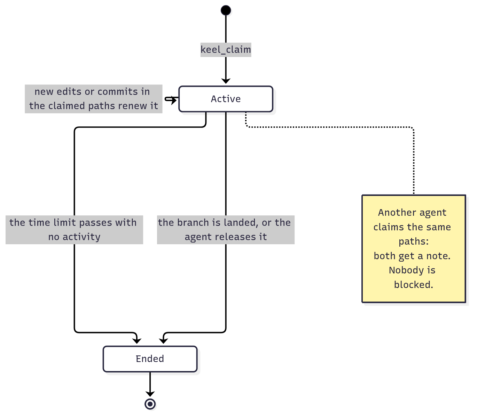

Larger: [SVG](img/keel-proposal/claim-life.svg) · [PNG](img/keel-proposal/claim-life.png)

<details>
<summary>Mermaid source of this diagram</summary>

<!-- diagram: claim-life -->
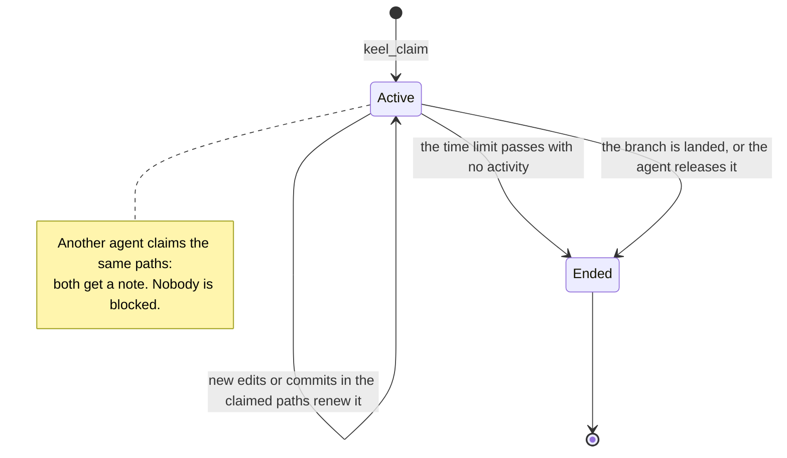

</details>

**15. Merge radar.** While branches are live, keel test-merges each pair in the background (`git merge-tree`, which
changes no working folder) and remembers the result per pair of commits. `keel_who`, `keel_workspace` and
`keel_status` then say: "feat/cart-remove and feat/restock both add lines to CHANGELOG.md: they will conflict."
Different agents on one repository conflict about twice as often as one agent with itself [R8], and keel's race
ended exactly this way [K1]. A choice for the spec: the test-merge should write its temporary objects to keel's
own folder. The no-`.keel`-folder plan allows git objects in the project's `.git`, so this is not a rule, but it
keeps unused objects out of the user's repository.

**16. Land in order.**

```text
call    keel_land(branches=["feat/discount", "feat/cart-remove", "feat/restock"])
answer  merged 3 of 3 into keel/land-12-22 (a new branch in keel's worktree; nothing pushed, main untouched)
        CHANGELOG.md: all three added lines at the same place: kept all, in merge order (check the order)
        tests on the result: 31 passed (2.4 s)
```

It is a helper any agent or the person can call, not a gate. It merges in the given order and tests the combined
code, as a merge queue does [R15]. A branch that breaks the result is left out and named with its failing test.
Lines are kept from both sides only where both sides only added lines; anything else is reported as a conflict.
It grows out of `keel_branch_sync`, which exists and which no agent used [K1].

**18 to 27, in one line each.**

- **18 Handoff notes.** `keel_note`, not `keel_handoff`, because keel already has `keel_handover` for another job.
  Three fields, kept per branch in keel's store; the next `keel_brief` or `keel_workspace` on
  that branch shows the last one in at most five lines.
- **19 Traps.** A fact of kind `trap` ("pytest needs `uvx` here: there is no `python` on PATH"). keel offers to
  save one when the same test failed twice and then passed. Short life (30 days) unless confirmed, because wrong
  experience hurts [R29].
- **20 Ready list.** Tasks with no open blocker and nobody on them. keel already refuses a second flow on the same
  ticket; here it only says who has it.
- **21 Review record.** In a small internal sample (a few review rounds on one pull request and one spec), a fresh
  reviewer ("goldfish") and one that knows the earlier rounds ("elephant") found different problems; in one round
  they had no finding in common. Cognition reports that a reviewer with a clean context "catches bugs the coder
  can't see" [R4]. Neither shows that the two together find everything. keel already stores review threads; this
  tool gives the earlier rounds to any agent, so the "elephant" does not depend on one session's memory.
- **22 Waiting without blocking.** After #250 every tool returns at once with a ticket. On top: the MCP Tasks
  extension where a client declares it [R34], and Claude Code's channel to tell an agent "your gate was answered"
  [R38]. Later, because support differs per client and channels are a preview.
- **23 Agents panel.** One page for the person. No start or stop buttons for connected agents: keel shows, it does
  not manage.
- **24 `keel_about(paths)`.** Useful in theory, risky in practice [R48]. Build it only behind a measurement.
- **25 Learned rules.** The largest item. It needs the Knowledge page, a review queue and good signals.
- **26 MCP 2026-07-28.** The new version has no sessions [R33]. keel's agent handle (features 7 and 12) is
  designed as a plain tool argument from the start, so this is mostly `server/discover` and cache hints.
- **27 Export.** Unchanged from the toolkit plan: only on request, because it writes into the repository.

### 3.5 Safety rules for the shared memory (feature 14)

All nine rules together are more than a week of work. The month ships a first slice, marked ① below: a citation
that is checked when the fact is shown (built on `keel_citations_check`, which exists), "replaced by" instead of
overwriting, the written-by label, and refusing secrets. The others follow before the memory is on by default.

| Rule | Why |
|---|---|
| ① A fact needs a citation (`path:line`), or it is marked `unverified` | [R19] |
| ① keel checks the citation when it shows the fact, and says "still there", "changed" or "gone" | [R18] [R19] |
| ① A new fact that disagrees with an old one does not overwrite it: the old one is marked "replaced by" | adding only piles up contradictions [R23]; last-write-wins loses edits [R24]; Graphiti invalidates instead of deleting [R25] |
| Facts run out after 90 days unless a check or a person confirms them; the person can set the time | Copilot's default [R18] |
| ① Every fact records which client wrote it and when; recalled facts are labelled as notes from other agents, not as instructions | one bad write can work for a long time [R31] [R32] |
| ① Values that look like secrets are refused; writes are limited per session (the limit comes later) | [R31]; CodeRabbit strips credentials before storing [R54] |
| At most a handful of facts are shown at once, only those for the topic or paths asked | unrelated memory breaks tasks [R29]; little at the start won [R30] |
| Rules that must always hold do not live in memory; they are the person's written rules in keel's settings | [R18] [R21] |
| The person sees, edits and deletes every fact on the Knowledge page | [R22] [R54] |

## 4. The system after

### 4.1 The whole system

This is the system when everything in this proposal and the whole no-`.keel`-folder plan are done. The month gets
part of the way: new light-path worktrees are outside the project from week 3, but the `.keel` folder of an
existing project moves only when that plan's last phase lands, which is not in the month.

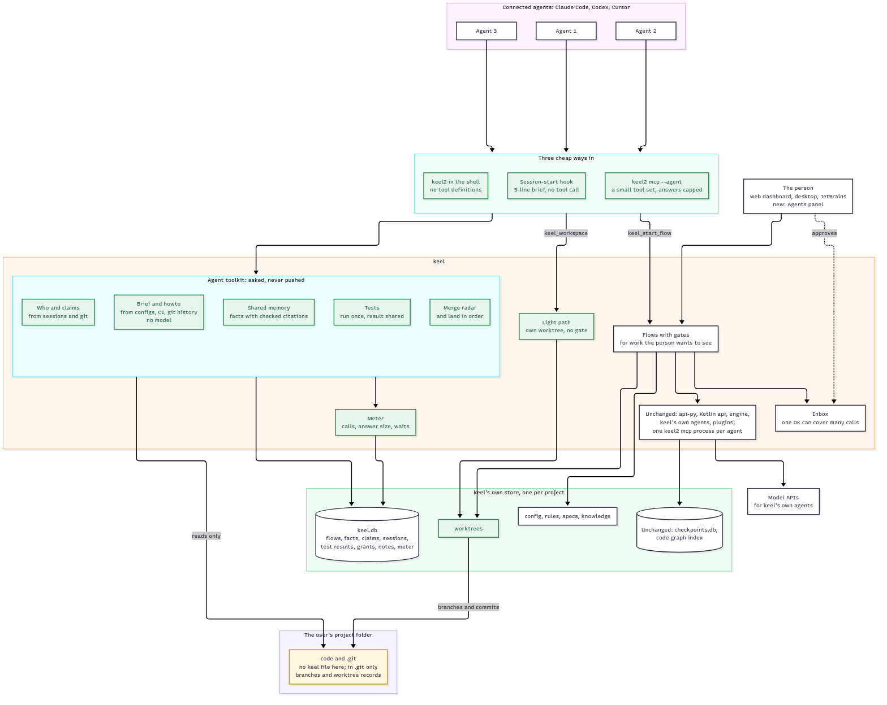

Larger: [SVG](img/keel-proposal/system-after.svg) · [PNG](img/keel-proposal/system-after.png)

<details>
<summary>Mermaid source of this diagram</summary>

<!-- diagram: system-after -->
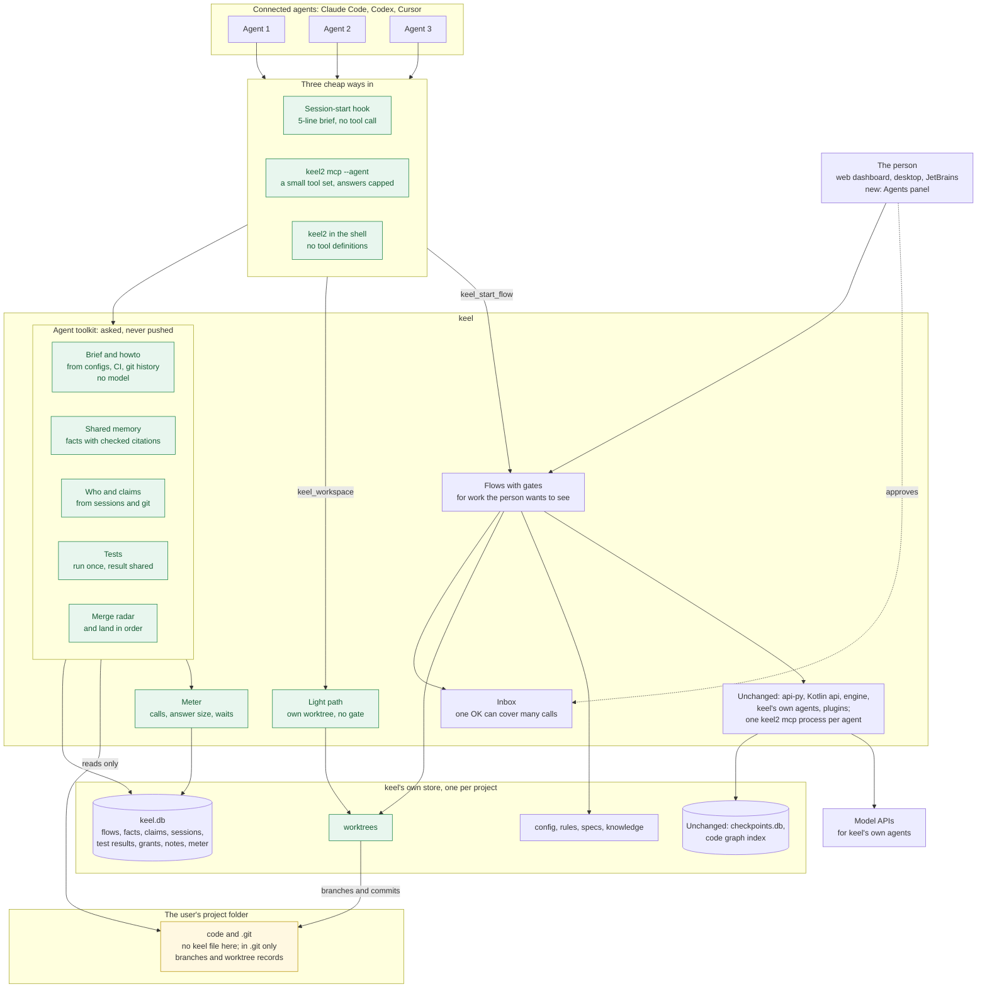

</details>

What changed against the picture in 1.1 (green = new):

| Before | After |
|---|---|
| One way in: 131 tools | Three cheap ways in: a brief by hook, a small tool set (12, later about 17), or the shell |
| To work through keel, a connected agent must run the `harness` flow | The agent chooses: the light path (no gate) or a flow (gates) |
| keel answers a connected agent only in part (search, knowledge pages, commit style); its test command, branch rules and worktrees serve its own flows | The toolkit answers any connected agent, and gives it a worktree and a test run without a flow |
| Agents cannot see each other | Who works on what, read from sessions and git; claims that expire |
| Every agent runs the tests | A result for the same code is shared |
| Three branches meet at the end | Conflicts are told early; `keel_land` merges in order and tests the result |
| One Inbox card per call | One OK can cover a kind of call for a flow or an hour |
| `.keel/`, a `.codegraph` link and worktrees inside the project | No keel file in the project; keel's own store; in `.git` only branches and worktree records |
| No numbers | A meter on every tool, and a race that runs every week |

The three servers (api-py, the Kotlin api, the engine), keel's own agents, the plugins and the one `keel2 mcp`
process per agent stay as they are; the picture shows them as one box, "Unchanged". The toolkit is new
code in the engine and the api, not a new server.

### 4.2 The same job, after

This is the target, not a measurement.

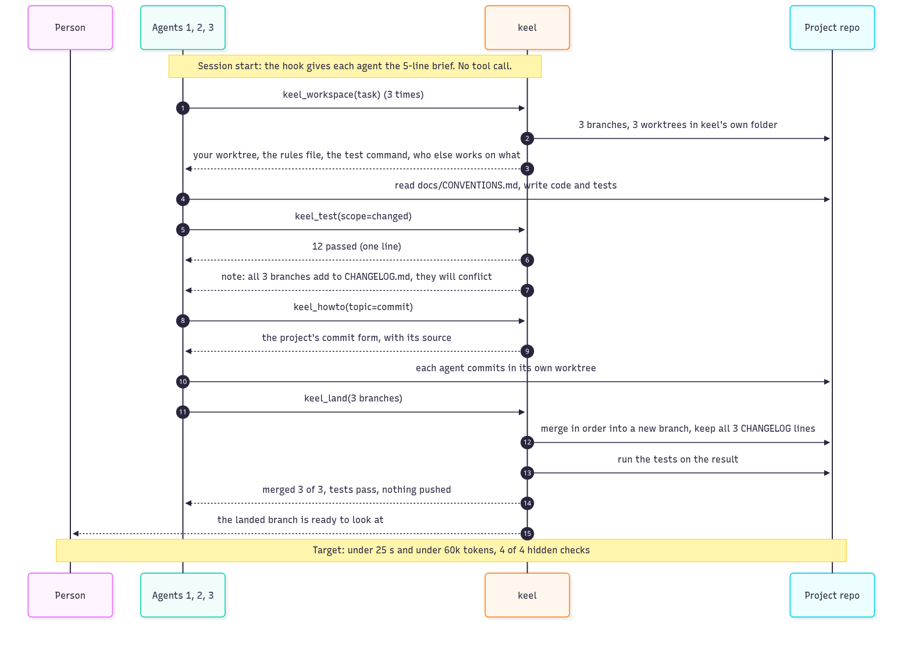

Larger: [SVG](img/keel-proposal/job-after.svg) · [PNG](img/keel-proposal/job-after.png)

<details>
<summary>Mermaid source of this diagram</summary>

<!-- diagram: job-after -->
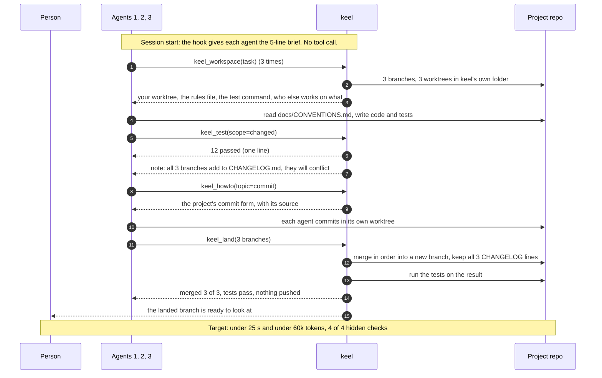

</details>

`keel_who` gives the "who else works on what" list of step 3 again at any time; the job is too short to need it.

What is gone: the session protocol text, the wrong work orders, the gates of each task (plan, done, PR), the
90-second waits, and the merge conflict at the end. What stays from keel's strengths: one worktree per agent, tests
run with keel's command, and a combined result that was tested before anyone sees it. If the person wants to approve
each task, the same job runs as three flows; after the base fixes that path should take seconds plus the person's
own time.

### 4.3 Where the data lives

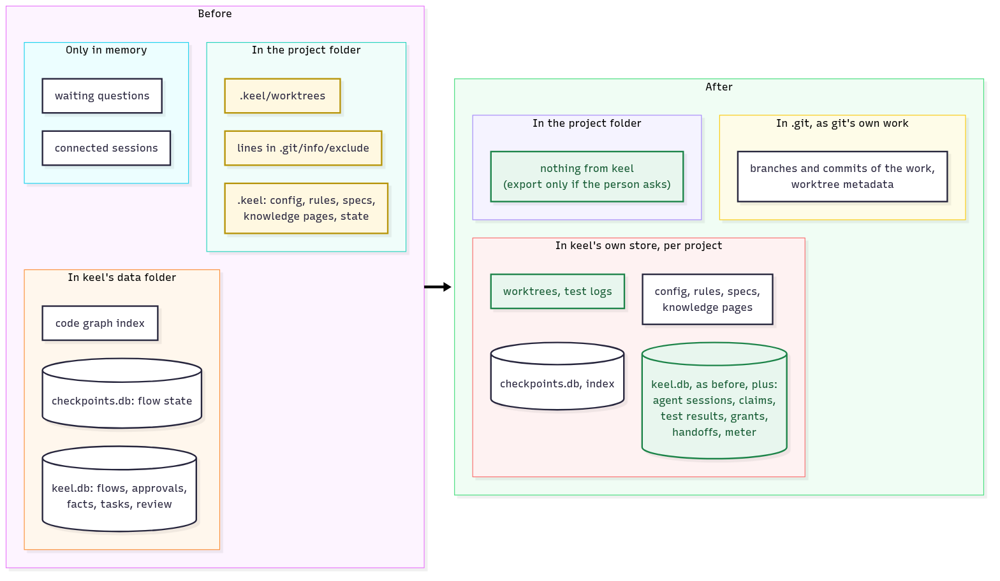

Larger: [SVG](img/keel-proposal/data-before-after.svg) · [PNG](img/keel-proposal/data-before-after.png)

<details>
<summary>Mermaid source of this diagram</summary>

<!-- diagram: data-before-after -->
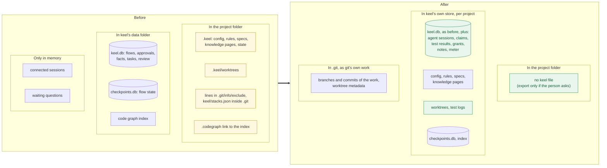

</details>

New rows in `keel.db` (all per project, none in the repository):

| Table | Holds | Used by |
|---|---|---|
| `agent_sessions` | a handle keel gives each connected agent, client name, worktree, branch, first and last seen | 7, 12, 23; fixes #219 for good |
| `claims` | paths, reason, who, until when | 13 |
| `facts` (exists) | adds: citation, written by, kind, last checked, replaced by, runs out at | 14, 19 |
| `test_runs` | command, content hash, result, short summary, path of the full log | 10, 11 |
| `notes` | branch or task, done, next, open | 18 |
| `grants` | the person's OKs for a kind of call | 17 (from #250) |
| `tool_calls` | tool, client, bytes out, duration, seconds waiting | 1 |

Sessions and waiting questions move from the engine's memory into the store, so a restart of keel does not lose
who is connected.

Every `keel_howto` and `keel_brief` answer is still computed on each call and stored nowhere, as the toolkit plan
says [K2].

## 5. The month, week by week

The chat's plan was: W1 fix the base and no `.keel` folder; W2 the small tool set; W3 `keel_howto`, `keel_brief`,
`keel_test`; W4 shared memory, `keel_who`, `keel_claim`, and the race again. This keeps that order and changes five
things: the meter and the race come first; the brief moves to week 2 because it is cheap and cuts fixed cost; the
light path is added in week 3, with keel's own worktrees folder before it; merge radar and landing join week 4;
and the final race is in the first week of January, because week 4 ends on a holiday and the runs need days of
their own.

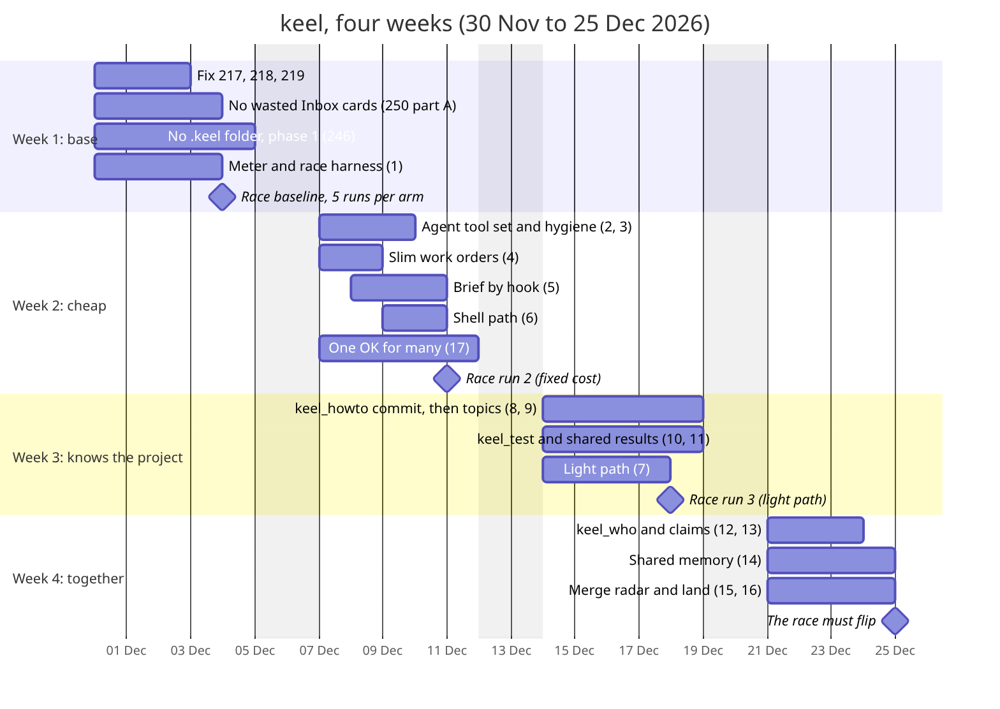

Larger: [SVG](img/keel-proposal/roadmap.svg) · [PNG](img/keel-proposal/roadmap.png)

<details>
<summary>Mermaid source of this diagram</summary>

<!-- diagram: roadmap -->
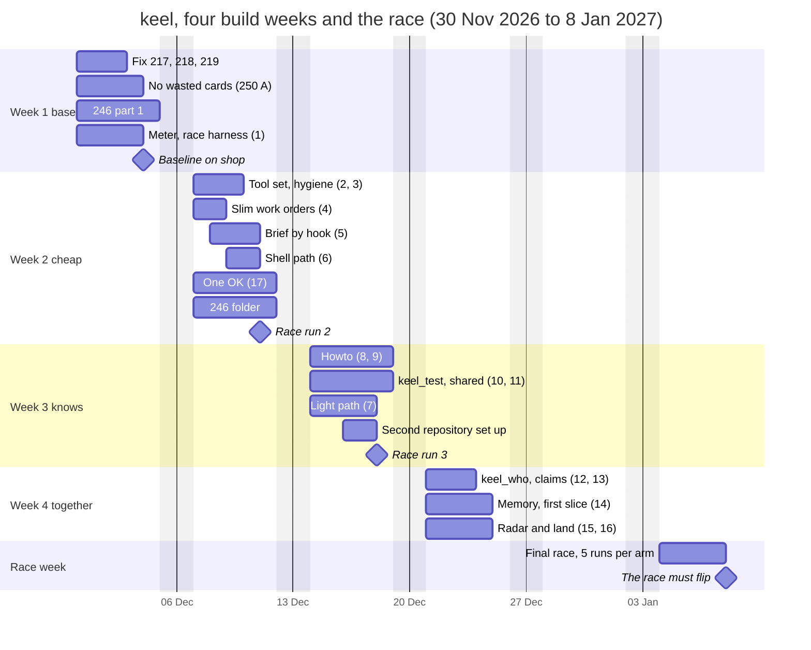

</details>

| Week | Build | Done when (measured) |
|---|---|---|
| **1** · 30 Nov to 4 Dec · the base | #217, #218, #219 · #250 part A · #246 phase 1 · feature 1, with the test machine set up so the client signs in and keel is connected the real way | The race of [K1] is run again on the fixed keel, on `shop`, 5 runs per arm, on Friday. It does not need #246. Expected: a large drop from 7.6 minutes. How large is not known: the one-agent keel run took 4.6 minutes and only 90 s of that is explained by #218 [K1], so the baseline also has to show where the rest goes. This is the baseline for the month. |
| **2** · 7 to 11 Dec · cheap | features 2, 3, 4, 5, 6, 17 · keel's own worktrees folder (pulled forward from #246 phase 3) | Race run 2, on Friday. A keel agent's tokens in the flow path are within 2k of a plain agent's. The 12 definitions are under 12 KB. No agent opens `docs/CONVENTIONS.md` without being pointed to it by the brief. The shell arm and the MCP arm are compared. |
| **3** · 14 to 18 Dec · knows the project | features 8, 9, 10, 11, 7 · the second, larger repository is set up for the race | Race run 3, on Friday. Three agents on the light path finish in about the time of three plain agents and commit in the project's style on the first try. `keel_land` comes a week later, so this week the harness merges the three branches with its fixed script (section 6), that time counts, and a conflict counts as a failed check. Each piece of code is tested once (only if feature 11 is in). A light-path task leaves no new file in the project folder. There is no `keel_who` yet; the "others" line comes from keel's own worktree list. |
| **4** · 21 to 24 Dec · together | features 12, 13, 15, 16, and the first slice of 14 | Checked in the race week, since week 4 has no Friday: `keel_land` merges the three branches without the harness script, and the merged result passes 4 of 4 hidden checks. No commit holds another agent's lines. |
| **Race week** · 4 to 8 Jan | no new features | **The race flips** (section 6): all arms, both repositories, 5 runs per arm. |
| After | features 18 to 27, the rest of 14, the later phases of #246 | Chosen by what the race and the meter show. |

Notes:

- The effort letters are for one agent with a reviewer. The squad runs at most three agents at once, so each week
  holds about three parallel pieces. By the effort letters the plan is too full: week 3 holds four M items and one
  S, more than three agents do in five days, and week 4 has five items in four working days. It fits only if some S
  and M guesses are too high, or the cut order below is used. We keep the full list and say so.
- **What to cut first if a week runs over**, in this order, with what falls away:
  1. 14, the memory: nothing in the race needs it.
  2. 17, one OK for many: only the click count of the K-flow arm.
  3. 11, shared test results: the lines "each piece of code is tested once" and half of the "test output" target.
  4. 9, more `keel_howto` topics: keep `commit` and `test`.
  5. 6, the shell path: the K-shell arm of week 2.
  6. 13, claims: `keel_who` still shows who changes which files.
  7. 15, the merge radar: no early warning; landing still merges and tests.
- **Do not cut:** the base, keel's own worktrees folder, 1, 2 to 5, 7, 8 (small, and the commit check needs it), 10,
  12, 16. Those carry the race: without 16 the three branches still meet in a CHANGELOG conflict and the pass rule
  of section 6 cannot be met.
- keel's feature freeze of 2026-11-18 still stands for everything that is not in this plan. Each week's list needs
  the maintainer's OK before the build starts, one spec at a time.
- A stop rule: if the run at the end of week 2 does not show the fixed cost under the target, week 3 starts with
  that, not with new tools.

## 6. The success test

**The claim to prove:** three agents with keel finish the same job sooner and with fewer tokens than three agents
without keel, and the result is at least as correct.

| Part | How |
|---|---|
| Job | The `shop` project and the three tasks of [K1], unchanged, with its four hidden checks. In the final race also a second, larger repository (about 1,000 files or more, three separate issues), because on a tiny project there is little to find and so little for keel to save. The weekly runs are on `shop` only. |
| Arms | **P1** one plain agent, three tasks · **P3** three plain agents, one folder (the arm of [K1]) · **P3-wt** three plain agents, each in its own git worktree · **K-light** three agents on keel's light path · **K-flow** three agents in keel flows, with the person bot answering gates · in week 2 also **K-shell** against **K-mcp** |
| Same for all | model, client and its version, machine and its limits, prompts. keel is set up in the client's own MCP settings, so tool names, instructions and loaded definitions are counted. The first race could not do this, because the client could not sign in on the test machine [K1]; that setup is part of week 1. |
| Runs | at least 5 per arm, the arms taken in turn, not one arm after the other. Report the median and the lowest and highest run. One run of the job takes seconds to a few minutes, so a weekly round fits in an hour. |
| One end point for all arms | The clock runs from the first prompt until the three tasks are in **one branch** and the hidden checks have run on it. P3 gets there by itself (one folder). For P3-wt, and for K-light before `keel_land` exists, the harness merges the three branches with one fixed script: plain `git merge` in task order, nothing fixed by hand, a conflict counts as failed checks. K-light with `keel_land` and K-flow end with keel's own merge. The merge time counts in every arm. |
| Measured | wall time as above · tokens from the client's own usage report (input, output, cache read and cache write, each on its own) · tool calls · test runs · clicks by the person · hidden checks on the one branch · for P3 also: commits that hold another agent's lines, and steps an agent had to repeat because another agent changed the folder (both happened in [K1]) |
| **Pass** | K-light's median wall time **and** median tokens are both below P3's, in at least 4 of 5 paired runs · 4 of 4 hidden checks on the merged branch in every K-light run. Nothing else is in the pass rule. |
| What keel adds beyond worktrees | K-light against P3-wt. Own worktrees are plain git. If K-light only matches P3-wt, the win over P3 comes from the worktrees and the report says so. keel's own part is what K-light does better than P3-wt: the merged result, the tests run once, fewer calls to find the rules. |
| Also reported | K-flow against P3. A flow waits for a person, so it is not asked to beat 25 seconds; the target is under twice P3's time with the bot, and at most 2k tokens per agent more than P3. |
| Honest line | P1 (17 s, 20k tokens) is expected to stay the cheapest on three tiny tasks. Nothing found in the research says parallel agents win on small work. The report must say so, and must say where keel was worse. |

Where the win has to come from, per agent (our estimate, to be replaced by the week 1 numbers):

| Part | Today | Target |
|---|---|---|
| Tool definitions | about 28k tokens in a client that loads all 131 [K1]; Claude Code loads names first, so there it is far less; not counted in the first race | under 3k if all 12 load (under 4k for 17); a few hundred where tools load on demand; none on the shell path |
| Fixed text of the session and the work order | 6k to 12k tokens over a plain agent [K1] | under 1k in a flow; none on the light path |
| Finding the rules | one search and one file read per agent | the brief (about 150 tokens) names the file |
| Test output | the whole output, once per agent and once by keel | one line when green; the same code tested once |
| Other agents in the way | 17 tool calls for three plain agents, against 4 for one agent doing all three tasks [K1] | none: own worktrees, landing in order |
| Waiting | minutes (#217, #218), then gates | none on the light path |

The last two rows are where keel can beat plain agents, not only match them. The first four only remove what keel
itself added.

## 7. Risks

| Risk | What we do about it |
|---|---|
| **The token margin on tiny tasks is thin.** A plain agent uses about 20k tokens, most of it its own system prompt. keel can save only what is wasted. | Measure on two sizes of project. If the tiny one ends level on tokens and ahead on time and checks, say exactly that. |
| **A tool that makes agents cheaper and worse** [R48]. | Hidden checks in every run. keel's tools add to grep and read. `keel_about` and the `where` topic only behind a measurement. |
| **Wrong, old or planted facts** in the shared memory [R29] [R31]. | The rules of section 3.5. The month ships only a first slice, off by default, and it is the first thing cut. |
| **Claims that nobody keeps.** | Read from git first; claims expire; count unused claims and drop the tool if they are most of them. |
| **The light path has no gates and no rule guard.** | It is the agent's own process, as without keel. Said plainly in the docs and in the tool's answer. A per-project switch. Flows stay for work that needs approval. The maintainer decides the default. |
| **Hooks touch the person's client settings**, and hook settings were the place a published attack on Claude Code used to stay on a machine [R32]. | Print by default, install only when asked, only into the person's own user-level file, never into a hook file inside the project. The hook only calls keel for five lines of text; the person can read it before adding it. Where a client has no user-level hook file, no install. |
| **Clients differ**: Codex stops a tool call after 60 s by default, Copilot's cloud agent reads hooks only from the repository, Cursor's session-start hook is fire-and-forget [R39] [R41] [R42]. | Build for the lowest common: fast answers, short results, no push. Test with at least two clients. |
| **Too much for four weeks**; #246 alone touches hundreds of places. | The cut order in section 5. #246 ships in four phases; the month needs phase 1 and the worktrees folder from phase 3. If that folder is late, the light path waits: it must not be built on today's worktree code. |
| **The MCP specification is moving** (2026-07-28 removes sessions) [R33]. | Agent identity is a handle keel gives out as a plain argument. Nothing new uses sampling, roots or logging. |
| **Noise in the measurements** [R56] [R57]. | Five runs per arm, arms taken in turn, same machine limits; small differences are not reported as wins. |
| **Private text in handoffs, facts and logs.** | Everything stays in keel's local store; values that look like secrets are refused; nothing is exported unless the person asks. |
| **More features against the goal of a stable core.** | Every feature has a number to watch in the meter. A tool nobody calls after a month is removed. |

## 8. Not found, guesses, and what was not checked

- **No independent measurement** of several coding agents sharing one tool, of shared test results, of a conflict
  warning before work starts, or of "tried and failed" memory. The gains here are our inference.
- **The `grite` paper** [R7] reports the largest gain (re-done work from 78% to 0%). It is one author's own tool; we
  read the abstract only. Do not quote it as proof.
- **Not confirmed:** whether Cursor still limits the number of MCP tools; which clients support the MCP Tasks and
  Skills extensions; whether Codex, Cursor, Copilot and Gemini load skills from MCP servers; how Cursor and Codex
  treat server `instructions` beyond what their docs say.
- **Not opened or search summaries only:** OpenHands, Amp, Jules and Devin's multi-agent docs (one page returned
  404); Windsurf's memory page; Serena's memory details; GitHub's dynamic toolsets page (404); the "Agent Trace"
  repository (404); prices of prompt-cache reads and writes.
- **Vendor numbers** (Cursor's semantic search, Augment's context engine, the memory benchmarks) are quoted as
  vendor numbers. The public CLI-against-MCP tests are small: one task on one server [R45], five tasks on one server [R46]; a third test found
  "more or less the same" for another tool [R47].
- **Guesses in this report:** every target number in sections 5 and 6; the 4,000-character cap (taken from one
  public test); the 12 KB and 16 KB budgets; 90 days for facts and 30 for traps; the rank order of the features;
  the effort letters.
- **Design points to check in the specs:** that `git merge-tree` can keep its temporary objects out of the
  project's `.git`; how a content hash for uncommitted changes is made without writing into the repository; whether
  Cursor's session-start hook delivers the brief in time; how keel's worktrees folder is mounted when keel runs in a container.
- **How the web was read:** most pages through a fetch tool that summarises. For the 27 sources marked ✔✔ a second
  reader opened the page again and compared the quotes; for five of those the raw page text was read. In review a
  third reader opened 24 of the sources and found three small mismatches, which are corrected here. Spot-check any
  other quote before it is used in public text.
- **Mermaid on GitHub is not confirmed.** In one check with a headless browser, GitHub drew the two sequence
  diagrams and showed "Unable to render rich display" for the three flowcharts, the state diagram and the chart.
  A control page did not load, so we cannot say if that is GitHub's viewer or the test browser. This is why the
  report shows pictures and folds the source. All seven sources render with Mermaid's own command-line tool (Mermaid 12.3.0).
- **keel's own state** was read from the code of 0.41.1 on 2026-11-26. `main` moves several times a day; #246 and
  #250 are plans on their branches and not in `main`.

## Sources

Web sources were read on 2026-11-26. "older" = more than a year old on that day. **✔✔** = two readers opened the
page and the quotes matched. **✔** = opened once, through a fetch tool that summarises. Sources seen only as a
search result are not used for any claim above; they are named in section 8.

keel's own:

- [K1] keel 0.40.0 MCP test report, `docs/test-report-mcp-0.40.0.md` (2026-11-24)
- [K2] keel as the agent's toolkit, `docs/research/agent-toolkit-plan.md` (2026-11-25, revised 2026-11-26). Its
  sources [S1] to [S32] are not repeated here.
- Two internal notes of 2026-11-26 are quoted in sections 1.3 and 3.4 without a link, because they are not in this
  repository: the squad's end-to-end test of keel 0.41.1 (its report is not merged yet) and the squad's log of
  building through keel, with a few review rounds. Treat their numbers as small samples.

Several agents on one repository:

- [R1] Claude Code docs, agent teams: https://code.claude.com/docs/en/agent-teams (undated) ✔
- [R2] Claude Code docs, manage costs: https://code.claude.com/docs/en/costs (undated) ✔✔
- [R3] Cursor, "Towards self-driving codebases" (Wilson Lin): https://cursor.com/blog/self-driving-codebases (2026-02-05) ✔✔
- [R4] Cognition, "Multi-Agents: What's Actually Working" (Walden Yan): https://cognition.com/blog/multi-agents-working (2026-04-22) ✔✔
- [R5] Anthropic, "How we built our multi-agent research system":
  https://www.anthropic.com/engineering/multi-agent-research-system (2025-06-13, older) ✔
- [R6] Khatua et al., "CooperBench: Why Coding Agents Cannot be Your Teammates Yet": https://arxiv.org/abs/2601.13295 (2026-01-19) ✔✔
- [R7] Sarkar, "Before the Pull Request: Mining Multi-Agent Coordination": https://arxiv.org/abs/2606.19616
  (2026-06-17; abstract only; the author's own tool) ✔✔
- [R8] Xu, Subramanian, Karthik, "AI Agent Pull Requests on GitHub: Frequency, Structure, and Merge Conflict Rates":
  https://arxiv.org/abs/2607.04697 (2026-07-06; abstract) ✔✔
- [R9] Ogenrwot, Businge, "AgenticFlict: A Large-Scale Dataset of Merge Conflicts in AI Coding Agent Pull Requests
  on GitHub": https://arxiv.org/abs/2604.03551 (2026-04-04; abstract) ✔✔
- [R10] Long et al., "ParallelPilot: Supporting Coordination and Monitoring in Parallel AI Coding":
  https://arxiv.org/abs/2609.33113 (2026-09-27; abstract) ✔✔
- [R11] Beads: https://github.com/steveyegge/beads (README, undated) ✔✔
- [R12] mcp_agent_mail: https://github.com/Dicklesworthstone/mcp_agent_mail (README, undated) ✔
- [R13] Gas Town: https://github.com/gastownhall/gastown (README, undated) ✔
- [R14] GitHub, "How to orchestrate agents using mission control":
  https://github.blog/ai-and-ml/github-copilot/how-to-orchestrate-agents-using-mission-control/ (2025-12-01) ✔
- [R15] GitHub docs, managing a merge queue:
  https://docs.github.com/en/repositories/configuring-branches-and-merges-in-your-repository/configuring-pull-request-merges/managing-a-merge-queue (undated) ✔
- [R16] Git docs, gitattributes (`merge=union`): https://git-scm.com/docs/gitattributes (undated) ✔
- [R17] towncrier docs: https://towncrier.readthedocs.io/en/stable/ (undated) ✔

Memory:

- [R18] GitHub docs, Copilot Memory: https://docs.github.com/en/copilot/concepts/agents/copilot-memory (undated) ✔✔
- [R19] GitHub, "Building an agentic memory system for GitHub Copilot":
  https://github.blog/ai-and-ml/github-copilot/building-an-agentic-memory-system-for-github-copilot/
  (2026-01-15, updated 2026-11-12) ✔✔
- [R20] Claude Code docs, memory: https://code.claude.com/docs/en/memory (undated) ✔
- [R21] Codex docs, memories: https://learn.chatgpt.com/docs/customization/memories (undated) ✔
- [R22] Devin docs, Knowledge: https://docs.devin.ai/product-guides/knowledge (undated) ✔
- [R23] mem0 docs, memory types: https://docs.mem0.ai/core-concepts/memory-types (undated) ✔
- [R24] Letta docs, memory blocks: https://docs.letta.com/guides/core-concepts/memory/memory-blocks (undated) ✔
- [R25] Graphiti: https://github.com/getzep/graphiti (README, undated) ✔
- [R26] Zep, "Lies, Damn Lies, & Statistics: Is Mem0 Really SOTA in Agent Memory?":
  https://www.getzep.com/blog/lies-damn-lies-statistics-is-mem0-really-sota-in-agent-memory/ (2025-05-06, older; a vendor about its rival) ✔
- [R27] Letta, "Benchmarking AI agent memory": https://www.letta.com/blog/benchmarking-ai-agent-memory (2025-08-12, older; vendor) ✔
- [R28] MCP reference servers, memory: https://github.com/modelcontextprotocol/servers/tree/main/src/memory (README, undated) ✔
- [R29] Chen et al., "MemDev-Bench: Does Memory Help Code Agents? Benchmarking Memory Systems over Real Repository
  Histories": https://arxiv.org/abs/2610.27524 (2026-10-20; abstract) ✔✔
- [R30] Chen et al., "REM: What to Store, When to Recall, What to Forget in Experience Memory for Coding Agents":
  https://arxiv.org/abs/2610.27377 (2026-10-19; abstract) ✔✔
- [R31] Dash et al., "From Untrusted Input to Trusted Memory: A Systematic Study of Memory Poisoning Attacks in LLM
  Agents": https://arxiv.org/abs/2606.04329 (2026-06-03; abstract) ✔✔
- [R32] Cisco, "Identifying and remediating a persistent memory compromise in Claude Code":
  https://blogs.cisco.com/ai/identifying-and-remediating-a-persistent-memory-compromise-in-claude-code (2026-04-01) ✔

MCP and token cost:

- [R33] MCP specification 2026-07-28, key changes: https://modelcontextprotocol.io/specification/2026-07-28/changelog ✔✔
- [R34] MCP extensions, Tasks: https://modelcontextprotocol.io/extensions/tasks/overview (undated) ✔✔
- [R35] MCP extensions, Skills: https://modelcontextprotocol.io/extensions/skills/overview (undated) ✔
- [R36] Claude Code docs, MCP: https://code.claude.com/docs/en/mcp (undated) ✔✔
- [R37] Claude Code docs, hooks: https://code.claude.com/docs/en/hooks (undated) ✔✔
- [R38] Claude Code docs, channels reference: https://code.claude.com/docs/en/channels-reference (undated; research preview) ✔
- [R39] Codex docs, MCP: https://learn.chatgpt.com/docs/extend/mcp (undated) ✔✔
- [R40] Codex docs, hooks: https://learn.chatgpt.com/docs/hooks (undated) ✔
- [R41] GitHub docs, Copilot hooks configuration: https://docs.github.com/en/copilot/reference/hooks-configuration (undated) ✔
- [R42] Cursor docs, hooks: https://cursor.com/docs/hooks (undated) ✔
- [R43] Claude API docs, tool search tool: https://platform.claude.com/docs/en/agents-and-tools/tool-use/tool-search-tool (undated) ✔✔
- [R44] Claude API docs, tool use with prompt caching:
  https://platform.claude.com/docs/en/agents-and-tools/tool-use/tool-use-with-prompt-caching (undated) ✔
- [R45] OpenRouter, "MCP vs CLI vs Skills": https://openrouter.ai/blog/insights/mcp-vs-cli-vs-skills/ (2026-11-11;
  one task, one server) ✔✔
- [R46] Scalekit, "MCP vs CLI": https://www.scalekit.com/blog/mcp-vs-cli-use (2026-03-11; a vendor) ✔
- [R47] Checkly, "MCP vs CLI token efficiency": https://www.checklyhq.com/blog/mcp-vs-cli-token-efficiency/ (2026-07-30) ✔

Project knowledge and measuring:

- [R48] Newell, "mcpbr: Benchmarking Model Context Protocol Servers on Software Engineering Tasks":
  https://zenodo.org/records/18627369 (2026-02-12; a preprint by one author) ✔✔
- [R49] Cursor, semantic search: https://cursor.com/blog/semsearch (2025-11-06, older by three weeks; vendor) ✔
- [R50] Gloaguen et al., "Evaluating AGENTS.md: Are Repository-Level Context Files Helpful for Coding Agents?":
  https://arxiv.org/abs/2602.11988 (v1 2026-02-12, v3 2026-09-29) ✔✔ (the full text was checked for [K2])
- [R51] Han et al., "SWE-Skills-Bench: Do Agent Skills Actually Help in Real-World Software Engineering?":
  https://arxiv.org/abs/2603.15401 (v1 2026-03-16, v2 2026-10-27; abstract) ✔✔
- [R52] GitHub, "How we make AI coding more cost efficient without sacrificing task quality":
  https://github.blog/ai-and-ml/github-copilot/how-we-make-ai-coding-more-cost-efficient-without-sacrificing-task-quality/ (2026-09-02) ✔✔
- [R53] Cursor, Bugbot learning: https://cursor.com/blog/bugbot-learning (2026-04-08; vendor) ✔
- [R54] CodeRabbit docs, learnings: https://docs.coderabbit.ai/knowledge-base/learnings (undated) ✔
- [R55] Entire docs, checkpoints: https://docs.entire.com/cli/checkpoints (undated) ✔
- [R56] Bjarnason, Silva, Monperrus, "On Randomness in Agentic Evals": https://arxiv.org/abs/2602.07150
  (2026-02-06, v3 2026-03-25; abstract) ✔✔
- [R57] Anthropic, "Quantifying infrastructure noise in agentic coding evals":
  https://www.anthropic.com/engineering/infrastructure-noise (2026-02-05) ✔✔
